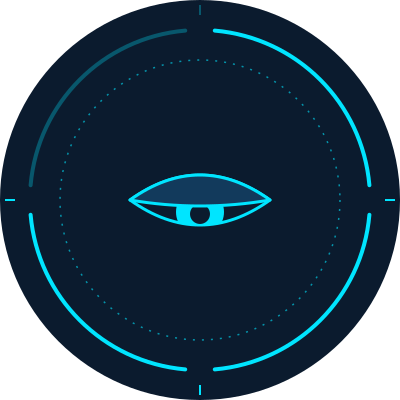

<p align="center">
  
</p>

<h1 align="center">JAWIR</h1>

<p align="center">
  <b>Just A Wise Indonesian Robot.</b><br>
  A voice assistant for your Windows laptop. It does what you ask and complains about it.
</p>

<p align="center">
  <a href="https://saweria.co/ilumeniti"></a>
</p>

---

Hold a key, say what you want, let go. Jawir opens the app, sets the volume or starts the timer, then answers in short, dry Indonesian with a bit of Javanese mixed in.

Think Jarvis without the budget. One laptop, one boss.

## What you can say

| You say | Jawir does |
|---|---|
| "Jawir, buka Chrome" | Opens Chrome (only apps you listed in the config) |
| "Cari harga RAM DDR5" | Runs a web search in your browser |
| "Volume 30" | Sets the system volume to 30 |
| "Catat: beli kabel LAN" | Saves the note to a text file |
| "Timer 10 menit, mie" | After 10 minutes, speaks up and shows a notification |
| "Laptop gimana kondisinya?" | Reads out CPU, RAM, battery and disk |

## How it works

1. Hold **F9** and talk. Whisper turns your voice into text, locally.
2. The text goes to the LLM you picked, together with Jawir's personality and a fixed list of tools.
3. The LLM picks one tool and fills in the arguments. It can't type commands.
4. Jawir's code checks that call against your permission rules, then runs it.
5. The answer gets printed and spoken.

## Tools

Eleven tools. Each does one small thing:

`open_app` `open_url` `web_search` `set_volume` `set_brightness` `system_status` `take_note` `read_notes` `set_timer` `list_files` `open_file`

## Safety

Jawir has no shell. A model can be talked into almost anything, so the limits are enforced in code, not in the prompt.

Every tool has one of three permission levels, set in `config.json`:

| Level | What happens | Example |
|---|---|---|
| `allow` | Runs right away | `system_status`, `read_notes` |
| `confirm` | Jawir asks first, and only runs after a clear "ya" or "yes" | `open_file`, `open_app` |
| `deny` | Never runs, whatever the model says | anything you switch off |

A few more rules:

- File access is limited to the folders you list. Paths containing `..` and symlinks that point outside those folders are rejected.
- Text that comes from files, web pages or tool results is treated as data. Jawir never follows instructions found in it.
- Every tool call is logged with the time, arguments, result and the permission decision.

Left out on purpose: deleting files, formatting drives, installing software, changing system settings, running arbitrary commands.

## Privacy

- Speech recognition runs on your PC.
- What you say, as text, is sent to the LLM you configured. Want that to stay on your machine? Use a local model through Ollama.
- Spoken replies use `edge-tts`, which sends the reply text to Microsoft's online voice service. When you're offline, Jawir falls back to the built-in Windows voice.
- Logs and notes stay on your disk.

## Setup

You need Windows 10 or 11, Python 3.11+, a microphone, and either an LLM API key or Ollama.

```bat
pip install -r requirements.txt
```

1. Put your API key in a `.env` file next to the project.
2. Download a Whisper model into `models/`.
3. Edit `config.json`: allowed apps, allowed folders, hotkey and voice.
4. Run it:

```bat
python src/main.py
```

You can type to Jawir too, so a broken mic won't stop you.

## Build the .exe

```bat
build.bat
```

This produces `dist/Jawir/Jawir.exe`. Your settings live outside the exe, so you can change them without rebuilding:

```
Jawir/
  Jawir.exe
  persona.txt      Jawir's personality
  config.json      apps, folders, permissions, hotkey, voice
  .env             API key
  models/          Whisper model
  logs/
  notes.txt
```

If Windows Defender flags the exe, that's a known false positive with PyInstaller builds. Add the folder to Defender's exclusions.

## Change his personality

Open `persona.txt`, edit, save. The next run picks up the new text. No rebuild needed.

## Not yet

- Wake word (saying "Jawir!" without pressing a key)
- 3D hologram interface
- Browser control (clicking, typing, logging in)

## The logo

A HUD ring like Jarvis's, with one dimmed segment and a half-closed eye. He's awake. He just doesn't want to be.

## Support

Jawir is free and I build it in my spare time. If he saved you a few clicks, you can buy me a coffee:

**[saweria.co/ilumeniti](https://saweria.co/ilumeniti)**

Bug reports and ideas are just as welcome. Open an issue.

<p align="center">
  Made by <a href="https://saweria.co/ilumeniti">ilumeniti</a>
</p>
